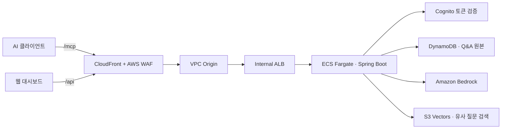

# ☁️ AWS CLF 학습 Q&A 노트 · 백엔드


AWS Certified Cloud Practitioner(CLF) 학습 중 생성한 Q&A를 원격 MCP로 저장하고, 유사 질문 검색과 개인별 학습 분석에 활용하는 Spring Boot 서버입니다. MCP 클라이언트에는 학습 도구를 제공하고, 웹 대시보드에는 REST API로 개인 기록과 통계를 전달할 계획입니다.

## ⚙️ 단계별 개발 계획

| 단계 | 주요 기능 | 관련 기술 |
| --- | --- | --- |
| **G0 · 기록 및 인증** | `save_qa`로 질문·답변·출처 저장, `rate_answer`로 이해도 기록, `delete_qa`로 삭제 | Cognito, DynamoDB, Remote MCP |
| **G1 · 의미 검색** | `search_past_qa`로 유사 질문 조회, 비동기 인덱싱과 실패 재시도 | Bedrock Embeddings, S3 Vectors, SQS, Lambda |
| **G2 · AI 응답과 분석** | `ask_study`로 과거 기록을 참고한 답변 생성 및 자동 저장, CLF 영역별 약점 집계 | Amazon Bedrock, DynamoDB Export, S3, Glue Data Catalog, Athena |

## 🏗️ 서비스 구성



- **MCP 및 REST API**는 Java와 Spring Boot로 구성합니다. MCP 전송 방식은 Streamable HTTP입니다.
- **학습 기록**은 DynamoDB에 보관합니다. 검색 시 S3 Vectors에서 찾은 Q&A ID로 원문을 조회하고 사용자 접근 권한을 다시 확인합니다.
- **배치 분석**은 EventBridge Scheduler로 실행할 계획입니다. DynamoDB Export 데이터를 S3에 저장하고 Glue Data Catalog와 Athena를 통해 집계합니다.
- **배포 및 운영**에는 ECR, ECS Fargate, Internal ALB, CloudFront, AWS WAF, CloudWatch를 사용합니다.

## 📂 디렉터리 구조 예시

MCP 도구와 REST 컨트롤러가 기능별 서비스 로직을 공유하는 예시입니다. `com.example.clfnotes`와 Gradle 파일명은 예시이며, SQS 소비 Lambda와 분석 배치의 코드는 팀의 배포 단위에 맞춰 배치합니다.

```text
.
├── src/
│   ├── main/
│   │   ├── java/com/example/clfnotes/
│   │   │   ├── ClfNotesApplication.java  # Spring Boot 진입점
│   │   │   ├── config/                   # AWS SDK 클라이언트 등 공통 설정
│   │   │   ├── auth/                     # Cognito 토큰 검증 및 사용자 식별
│   │   │   ├── mcp/                      # Streamable HTTP 설정 및 MCP 도구 등록
│   │   │   │   ├── QaTools.java           # save_qa, rate_answer, delete_qa
│   │   │   │   ├── SearchTools.java       # search_past_qa
│   │   │   │   └── StudyTools.java        # ask_study
│   │   │   ├── qa/
│   │   │   │   ├── QaController.java      # 웹 대시보드용 학습 기록 REST API
│   │   │   │   ├── QaService.java         # 기록·피드백·삭제 및 소유권 확인
│   │   │   │   ├── QaRecord.java          # 질문·답변·출처·피드백 모델
│   │   │   │   └── QaRepository.java      # DynamoDB 조회 및 조건부 쓰기
│   │   │   ├── search/
│   │   │   │   ├── SearchController.java  # 웹 대시보드용 검색 REST API
│   │   │   │   ├── SearchService.java     # 벡터 검색 후 Q&A 원문 조회
│   │   │   │   ├── EmbeddingClient.java   # Bedrock 질문 임베딩
│   │   │   │   ├── VectorSearchClient.java # S3 Vectors 조회
│   │   │   │   └── IndexingPublisher.java # SQS에 인덱싱 이벤트 발행
│   │   │   ├── study/
│   │   │   │   ├── StudyService.java      # 검색 문맥 구성·답변 생성·자동 저장
│   │   │   │   └── BedrockAnswerClient.java # Bedrock 생성 모델 호출
│   │   │   └── analytics/
│   │   │       ├── AnalyticsController.java # 개인 학습 통계 REST API
│   │   │       └── AnalyticsService.java  # S3에 저장된 분석 결과 조회
│   │   └── resources/
│   │       └── application.yml            # Spring Boot 공통 설정
│   └── test/java/com/example/clfnotes/   # 기능별 단위·통합 테스트
├── docs/                                 # MCP 도구·REST API·배포 문서
├── Dockerfile                            # ECS 배포용 컨테이너 이미지 정의
├── gradle/wrapper/                       # Gradle Wrapper 설정
├── gradlew                               # macOS·Linux 실행 스크립트
├── gradlew.bat                           # Windows 실행 스크립트
├── build.gradle                          # 의존성 및 빌드 설정
├── settings.gradle                       # Gradle 프로젝트 설정
└── README.md
```

## 🚀 로컬 실행 예시

JDK를 설치하고 **백엔드 저장소 루트**에서 실행합니다. 아래 명령은 Gradle Wrapper를 사용하는 경우의 예시입니다.

**Windows PowerShell**

```powershell
.\gradlew.bat bootRun
```

**macOS · Linux**

```sh
./gradlew bootRun
```

AWS 연동을 테스트할 때는 사용하는 기능에 맞춰 AWS 자격 증명, 리전, Cognito 설정과 DynamoDB 등의 리소스 정보를 구성합니다. 배포 환경에서 MCP 클라이언트는 `/mcp`로 연결하고, 웹 대시보드는 `/api`로 데이터를 조회합니다.

## 👥 팀원별 역할

| 팀원 | 담당 영역 | 주요 작업 |
| --- | --- | --- |
| 허유정 | MCP 서버·컨테이너 | MCP 도구 연결, ECS Fargate 배포, 태스크 복구 |
| 김서영 | 인증·보안 | Cognito 토큰 검증, 사용자별 데이터 격리 |
| 손민별 | 저장·피드백 | DynamoDB 데이터 모델, 저장·평가·삭제, 중복 요청 처리 |
| 선지오 | 의미 검색 | 임베딩, S3 Vectors 검색, 인덱싱 재시도 |
| 임유정 | AI 응답 | `ask_study`, 답변 문맥 구성 및 출처 표시 |
| 나혜윤 | 분석 파이프라인 | DynamoDB Export, Glue·Athena 기반 약점 집계 |
| 안정현 | 웹·배포 연동 | 대시보드, REST API 연동, S3·CloudFront 배포 |

> 디렉터리와 실행 명령은 예시입니다. JDK 버전, 빌드 도구, 환경 변수 이름과 포트는 실제 저장소 설정에 맞춰 업데이트합니다.
