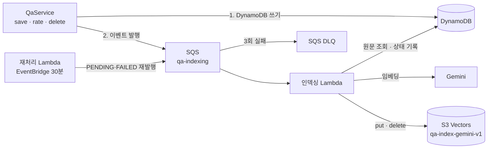

# QA 벡터 인덱싱 명세 (INT-001~003)

> 담당: ④ 의미 검색 · 대상: ③ 저장·피드백 (이벤트 발행, DynamoDB 필드), ① (SQS·Lambda 배포)
> 단계: G1 · 관련 문서: [search-api.md](search-api.md), [embedding.md](embedding.md)
> 표시 ⚠️ = 팀 확인이 필요한 결정

## 1. 한눈에 보기



**핵심 원칙: Lambda는 이벤트 내용보다 DynamoDB의 현재 상태를 믿는다.**
이벤트를 받으면 항상 DynamoDB에서 QA를 다시 읽고, 있으면 벡터를 그 상태에 맞추고, 없으면 벡터를 지운다.
그래서 SQS가 순서를 바꾸거나 같은 메시지를 두 번 보내도 결과는 DynamoDB와 같아진다.

| 번호 | 트리거 | DynamoDB (③) | 이벤트 `op` | Lambda 처리 |
| --- | --- | --- | --- | --- |
| INT-001 | `save_qa` | 저장, `embeddingStatus=PENDING` | `UPSERT` | 임베딩 → 벡터 저장 → `COMPLETED` |
| INT-002 | `rate_answer` | `latestFeedback` 갱신 | `UPDATE_META` | 벡터 메타데이터만 갱신 (재임베딩 없음) |
| INT-003 | `delete_qa` | 완전 삭제 | `DELETE` | 벡터 삭제 |

인덱싱 대상은 `SK = QA#...` 항목뿐입니다. MESSAGE·SESSION은 이벤트를 보내지 않습니다.

## 2. 이벤트 메시지 (공통)

```json
{
  "schemaVersion": 1,
  "eventId": "01JDXK9Q7M3T5V8W2Y4Z6A1B3C",
  "op": "UPSERT",
  "userId": "c4a8...-cognito-sub",
  "qaId": "01JDXK9Q5H2...",
  "requestedAt": "2026-11-27T07:12:30.123Z"
}
```

| 필드 | 설명 |
| --- | --- |
| `schemaVersion` | 형식이 바뀌면 올림. Lambda는 모르는 버전을 DLQ로 보냄 |
| `eventId` | ULID. 로그 추적용 (중복 제거에는 쓰지 않음, 처리 자체가 멱등) |
| `op` | `UPSERT` / `UPDATE_META` / `DELETE` |
| `userId`, `qaId` | DynamoDB 키 `USER#<userId>` / `QA#<qaId>` |
| `requestedAt` | 발행 시각 (ISO-8601 UTC) |

- **질문·답변 원문은 메시지에 넣지 않습니다.** 원문은 DynamoDB에서만 읽습니다 (개인 학습 기록이 큐와 DLQ에 14일씩 남지 않게, 256KB 제한 회피).
- 코드: `search/IndexingEvent.java`(메시지), `search/IndexingPublisher.java`(발행 인터페이스). SQS 구현체는 큐가 생기면 추가합니다.

## 3. INT-001 `UPSERT` (save_qa)

**③ 발행 쪽**
1. DynamoDB에 QA 저장 (`embeddingStatus=PENDING`)
2. `IndexingPublisher.upsert(userId, qaId)` 호출
3. 발행이 실패해도 `save_qa`는 **성공으로 응답**합니다. 저장은 이미 끝났고, 6-3의 재처리가 PENDING으로 남은 QA를 다시 발행합니다. 실패는 경고 로그로 남깁니다.

**Lambda 처리**
1. DynamoDB `GetItem`(강한 일관성 읽기). 없으면 → `DeleteVectors` 후 종료 (이미 삭제된 QA)
2. `embeddingStatus=PROCESSING` 기록
3. `EmbeddingProvider.embedDocument(도메인 영어 이름, question)` — QA 1건씩 호출
4. `PutVectors` (key=`qaId`, 메타데이터는 [search-api.md 9절](search-api.md#9-벡터-메타데이터-인덱스-qa-index-gemini-v1))
5. DynamoDB 다시 확인. 그 사이 삭제됐으면 → `DeleteVectors` (삭제와 동시에 처리된 경우 대비)
6. `embeddingStatus=COMPLETED`, `embeddingModel`, `indexedAt` 기록

도메인 영어 이름: `CONCEPTS`=Cloud Concepts, `SECURITY`=Security and Compliance, `TECH`=Cloud Technology and Services, `BILLING`=Billing, Pricing, and Support, `UNCLASSIFIED`=없음(`none`)

## 4. INT-002 `UPDATE_META` (rate_answer)

S3 Vectors에는 메타데이터만 바꾸는 API가 없어서 기존 벡터 값을 읽어 다시 씁니다.

1. DynamoDB `GetItem`. 없으면 → `DeleteVectors` 후 종료
2. `GetVectors`(`returnData=true`)로 기존 벡터 조회
   - 벡터가 없으면(아직 인덱싱 전) 아무것도 안 하고 종료. 나중에 UPSERT가 그때의 최신 메타데이터로 저장합니다.
   - 벡터의 모델이 현재 모델과 다르면 UPSERT와 같이 다시 임베딩
3. 같은 벡터 값 + DynamoDB의 현재 `latestFeedback`·`verification`으로 `PutVectors`

이벤트에 피드백 값을 싣지 않고 DynamoDB에서 읽기 때문에, 평가를 빠르게 여러 번 바꿔 이벤트 순서가 뒤집혀도 마지막 값이 남습니다.

## 5. INT-003 `DELETE` (delete_qa)

1. DynamoDB `GetItem`. **있으면** 종료 (삭제 이벤트가 잘못 왔거나 같은 qaId가 다시 생긴 경우, 지우지 않음)
2. `DeleteVectors(keys=[qaId])`. 없는 키를 지워도 오류 없이 성공합니다 (2026-11-28 PoC에서 확인). 그래서 중복 삭제도 안전합니다.

③ 발행 쪽: 발행이 실패해도 `delete_qa`는 성공으로 응답합니다. 벡터가 남아도 검색 단계에서 DynamoDB 재조회로 걸러지므로 사용자에게 보이지 않고, 7-3번 정리 작업이 지웁니다.

## 6. 실패와 재처리

### 6-1. 오류 구분

| 오류 | 예 | 처리 |
| --- | --- | --- |
| 재시도 가능 | Gemini 429·408·5xx·네트워크 (`EmbeddingException.isRetryable()=true`), S3 Vectors·DynamoDB 스로틀링·5xx | 이 메시지만 실패로 반환 → SQS가 다시 전달 |
| 재시도 불가 | Gemini 400·401·403, 차원 불일치, 모르는 `schemaVersion`·`op` | 바로 `FAILED` 기록, 메시지는 성공 처리(삭제) |

- 재시도 가능 오류가 3번째 수신(`ApproximateReceiveCount >= 3`)에서도 나면 `FAILED`를 기록하고 실패로 반환 → DLQ로 이동
- 모르는 `schemaVersion`·`op`는 DynamoDB에 기록할 대상이 불분명하므로 실패로 반환해 DLQ로 보냅니다.

### 6-2. SQS·Lambda 설정

| 항목 | 값 | 이유 |
| --- | --- | --- |
| 큐 | `qa-indexing-dev` (표준 큐) | 처리가 멱등이라 FIFO 불필요 |
| DLQ | `qa-indexing-dev-dlq`, 보관 14일 | |
| `maxReceiveCount` | 3 | |
| 가시성 제한시간 | 180초 | Lambda 제한시간의 6배 (AWS 권장) |
| Lambda 제한시간 | 30초 | 임베딩 10초 + S3 Vectors·DynamoDB |
| 배치 크기 | 10, `ReportBatchItemFailures` 사용 | 실패한 메시지만 다시 받음 |
| 최대 동시 실행 | 2 (이벤트 소스 매핑 `MaximumConcurrency`) | Gemini 호출 한도 보호. 2가 설정 가능한 최솟값 |

### 6-3. 재처리 (EventBridge Scheduler, 30분마다)

재처리 Lambda가 아래 QA에 `UPSERT`를 다시 발행합니다.

| 대상 | 조건 |
| --- | --- |
| 발행 누락 | `PENDING` 또는 `PROCESSING`이고 `updatedAt`이 10분 이상 지남 |
| 실패 | `FAILED`이고 `embeddingAttempts < 5` |

- 재처리할 때마다 `embeddingAttempts`를 1 올립니다. 5번 넘게 실패한 QA는 자동 재처리를 멈추고 알람(CloudWatch) 대상으로 둡니다.
- 대상 찾기: GSI2를 없앴으므로 처음에는 `Scan` + 필터로 찾습니다(G1 데이터 규모에서는 비용 무시 가능). ⚠️ 데이터가 늘면 미완료 QA에만 값을 넣는 sparse GSI로 바꿉니다.
- DLQ 메시지: 원인을 고친 뒤 SQS 콘솔의 "DLQ 재드라이브"로 원래 큐에 되돌립니다. 6-3 재처리가 어차피 다시 발행하므로 급하지 않습니다.

## 7. 삭제 정합성 (③과 합의 필요)

### 7-1. 검색 결과에 삭제된 QA가 나오지 않는 이유

벡터 삭제는 비동기라 잠깐 벡터만 남을 수 있습니다. 하지만 검색은 항상 DynamoDB에서 원문을 다시 읽고 없는 QA는 버리므로 결과에 나오지 않습니다 ([search-api.md 7-5](search-api.md#7-처리-흐름)).

### 7-2. 경쟁 상황

| 상황 | 결과 |
| --- | --- |
| DELETE가 UPSERT보다 먼저 처리 | UPSERT 1단계에서 QA가 없음 → 벡터 삭제, 종료 |
| UPSERT 처리 중에 QA 삭제 | UPSERT 5단계 재확인에서 삭제 발견 → 벡터 삭제 |
| UPDATE_META가 DELETE 뒤에 도착 | 1단계에서 QA 없음 → 벡터 삭제, 종료 |
| 같은 이벤트 중복 전달 | 같은 key로 덮어쓰기·삭제라 결과 동일 |

### 7-3. 남은 벡터 정리 (주 1회)

발행 실패 등으로 남은 벡터를 지웁니다. `ListVectors`로 전체 key를 읽고 DynamoDB에 없는 `qaId`는 `DeleteVectors`. 재처리 Lambda에 같이 넣습니다.

### 7-4. ③에 요청하는 DynamoDB 처리

| 요청 | 내용 |
| --- | --- |
| 추가 필드 | `embeddingModel`(string), `indexedAt`(timestamp), `embeddingAttempts`(number), `embeddingError`(string, 오류 코드만) |
| 필드 제외 | 인수인계 초안의 `vectorKey`는 `qaId`와 같아서 두지 않음 |
| 상태값 | 기존 `EmbeddingStatus`(`PENDING`·`PROCESSING`·`COMPLETED`·`FAILED`) 그대로 사용. 완전 삭제라 `DELETED`는 필요 없음 |
| Lambda의 쓰기 방식 | 임베딩 필드만 `UpdateItem`(`SET embeddingStatus = ...`) + 조건 `attribute_exists(PK)`. 전체 항목을 다시 저장하지 않음 → 삭제된 QA가 되살아나거나 `latestFeedback`을 덮어쓰지 않음. `version`은 올리지 않음 (사용자 쓰기의 낙관적 락과 충돌 방지) |
| 질문·답변 수정 | 지금은 수정 기능이 없어 원문이 바뀌지 않는다고 가정합니다. ⚠️ 수정 기능이 생기면 수정 시 `UPSERT` 재발행 |

## 8. 기존 QA 일괄 인덱싱 (백필)

G0에서 인덱싱 없이 저장된 QA, 그리고 모델·차원을 바꿀 때 씁니다. **별도 경로를 만들지 않고 같은 큐에 `UPSERT`를 넣습니다.** 처리 속도는 6-2의 최대 동시 실행 수로 제한되어 Gemini 호출 한도를 넘지 않습니다.

1. `Scan` (`SK begins_with "QA#"`) — MESSAGE·SESSION은 제외
2. 대상: `embeddingStatus != COMPLETED` 또는 `embeddingModel != 현재 모델`
3. `SendMessageBatch`(10건씩)로 `UPSERT` 발행
4. 끝나면 `COMPLETED` 개수와 전체 QA 개수 비교, `FAILED`는 6-3 재처리에 맡김

- 실행: 한 번 쓰는 스크립트(CloudShell, Python boto3)로 시작하고, 반복해서 쓰게 되면 재처리 Lambda에 "백필 모드"로 합칩니다.
- 임베딩은 QA마다 1건씩 호출합니다. 여러 텍스트를 한 요청에 넣으면 하나로 합쳐집니다.

### 모델·차원을 바꿀 때 (재임베딩)

기존 벡터와 호환되지 않으므로 새 인덱스를 만들어 옮깁니다.

1. 새 인덱스 생성 (예: `qa-index-gemini-v2`)
2. Lambda의 쓰기 대상을 새 인덱스로 바꾸고 백필 실행 (`embeddingModel != 새 모델` 대상)
3. 백필이 끝나면 검색 서버의 읽기 인덱스를 새 인덱스로 전환
4. 이전 인덱스 삭제

전환 중에는 검색이 이전 인덱스를 계속 읽으므로 검색이 끊기지 않습니다.

## 9. 결정 필요 ⚠️

| 항목 | 제안 | 상대 |
| --- | --- | --- |
| 발행 실패 시 `save_qa`·`delete_qa` 응답 | 성공으로 응답하고 재처리에 맡김 | ③ |
| 7-4 추가 필드와 Lambda 쓰기 방식 | 위 표대로 | ③ |
| 재처리 대상 조회 | 우선 Scan, 커지면 sparse GSI | ③ |
| 이벤트 발행 방식 | 지금은 앱에서 SQS 직접 발행. 대안: DynamoDB Streams → Lambda (발행 누락이 없고 항목별 순서 보장, 대신 앱 밖에서 변경을 판단) | ①, ③ |
| Lambda 코드 위치·언어 | 서버와 같은 Java(임베딩 코드 재사용) 또는 Python | ① |
